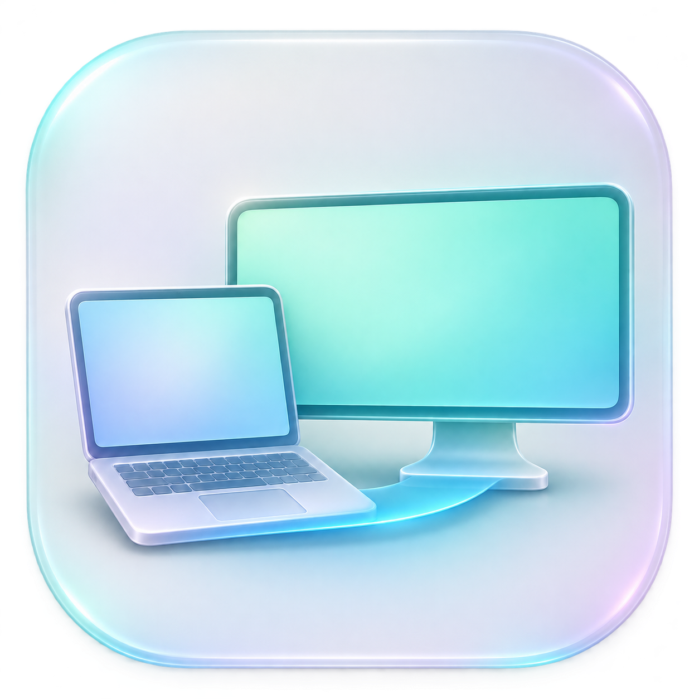
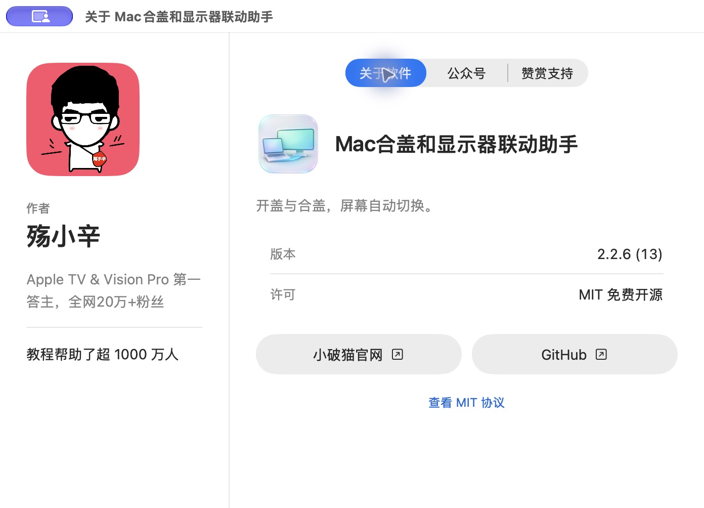

# Mac合盖和显示器联动助手

**免费开源 · MIT · 测试版 v2.2.7-beta.1 · Apple 芯片 Mac · macOS 14+**

开盖用 Mac，合盖用外接屏。一个根据 MacBook 开合盖状态，自动切换显示器的 macOS 菜单栏工具。

也可以自定义为开盖只用外接屏，或同时使用 Mac 与外接屏。

## 功能

- 开盖选择只用 Mac、只用外接屏或同时使用。
- 同时使用支持镜像与扩展；扩展时可选择主显示器。
- 合盖后使用选中的外接显示器。
- 自动识别已连接的显示器，确认加入联动后再设置规则。
- 为不同屏幕保存分辨率、刷新率与 HDR 偏好。
- 可设置开盖切换延时和登录后启动。
- 提供“恢复所有显示器并暂停”，方便返回正常显示状态。
- 菜单栏“关于…”采用作者主页布局，分为软件信息、公众号和赞赏支持，二维码支持点击放大。

## 下载与安装

[下载测试版 DMG](https://github.com/xinlaoshi/mac-lid-display-helper/releases/download/v2.2.7-beta.1/MacDisplaySwitch-2.2.7-AppleSilicon.dmg) · [全部版本与 ZIP](https://github.com/xinlaoshi/mac-lid-display-helper/releases) · [使用说明](docs/installation.md)

App 内版本为 2.2.7 (14)，内部名称为 MacDisplaySwitch。请下载上面的 App 安装包；GitHub 自动生成的 Source code 压缩包用于查看和编译源码。

1. 打开 DMG，将 App 拖入 Applications（应用程序）。
2. 从“应用程序”打开 App，点击菜单栏图标 →“设置…”。
3. 连接显示器，在“设备与输出”中将目标屏幕加入联动。
4. 设置开盖与合盖动作，点击“保存”。需要自动运行时，开启“登录后启动”并保存。

当前安装包内的 App 已完成 Developer ID 签名和 Apple 公证，并附带公证票据。首次打开仍可能出现正常的互联网下载确认；确认来源后点击“打开”即可，通常无需到系统设置手动放行。升级后请从“应用程序”手动打开新版一次，以更新已有登录启动项的执行路径。

## 关于界面

采用作者主页布局，软件信息、公众号与赞赏支持分开查看。

## 系统与硬件要求

- Apple 芯片（M 系列）Mac，macOS 14 或更新版本。
- 自动开合盖联动面向带内置屏幕的 MacBook。
- 当前发布包不支持 Intel Mac。
- 外接屏、接口与线材需支持所选输出模式。4K、120Hz 与 HDR 不保证能在所有组合上使用。
- 合盖使用仍需满足 macOS 与硬件自身的运行条件。

## 常见问题

**支持其他品牌显示器吗？**

程序按系统显示器身份识别设备，不按品牌名称匹配。其他屏幕可加入联动；目前实际切换验收以开发机与 LG 组合为主，不代表已在所有品牌上验证。

**会自动选择电视 HDMI 输入源吗？**

不会。这里控制的是 Mac 的视频输出；电视需开机并切到正确输入源。

**镜像时为什么不能分别设置主副屏？**

镜像由 macOS 协调公共显示模式，不需要选择主副屏。独立的分辨率、刷新率与 HDR 偏好在扩展或单屏使用时应用。

**切换后没有画面怎么办？**

先打开 Mac 上盖，再从菜单栏选择“恢复所有显示器并暂停”。也可检查显示器电源、输入源与线材连接。若仍有问题，请在 Issues 提交 Mac 型号、macOS 版本、连接方式与操作步骤。

**需要联网或注册账号吗？**

当前 App 不需要账号，不包含广告、应用内支付、遥测或联网服务。设置与运行日志保存在当前 Mac 用户目录。向 Issues 提交日志或截图前，请检查是否包含不想公开的信息。详见[隐私说明](docs/privacy.md)。

## 兼容性说明

屏幕启停及 HDR 控制使用部分非公开系统接口，macOS 更新可能影响兼容性。当前仅在有限硬件上完成实际验收；镜像/扩展的新实现尚未完成物理双屏验收。建议先在自己的设备上确认显示恢复与切换行为。

## 卸载

关闭“登录后启动”并保存，选择菜单栏“退出并恢复显示器”，再将 App 移到废纸篓。

## 支持开发

这个工具免费使用，采用 MIT 协议开源。如果它让你的桌面切换更省心，欢迎自愿请我喝杯咖啡，支持后续适配和维护。

打赏完全自愿，不影响功能使用，也不作为功能交付或修复时限的承诺。

## 关注殇小辛的公众号

Apple TV & Vision Pro 第一答主，全网20万+粉丝

教程帮助了超 1000 万人

扫码关注获取 Vision Pro 和 Apple TV 教程合集

更多内容：[小破猫官网](https://xiaopomao.com)。赞赏与关注入口也可从 App 菜单栏“关于…”打开。

## 源码与许可

采用 [MIT 许可证](LICENSE)，允许按许可证条款使用、修改和分发。第三方参考与许可见 [致谢](ACKNOWLEDGEMENTS.md)。

开发者可参考[构建说明](docs/building.md)。当前测试范围和限制见[兼容性说明](docs/compatibility.md)。
