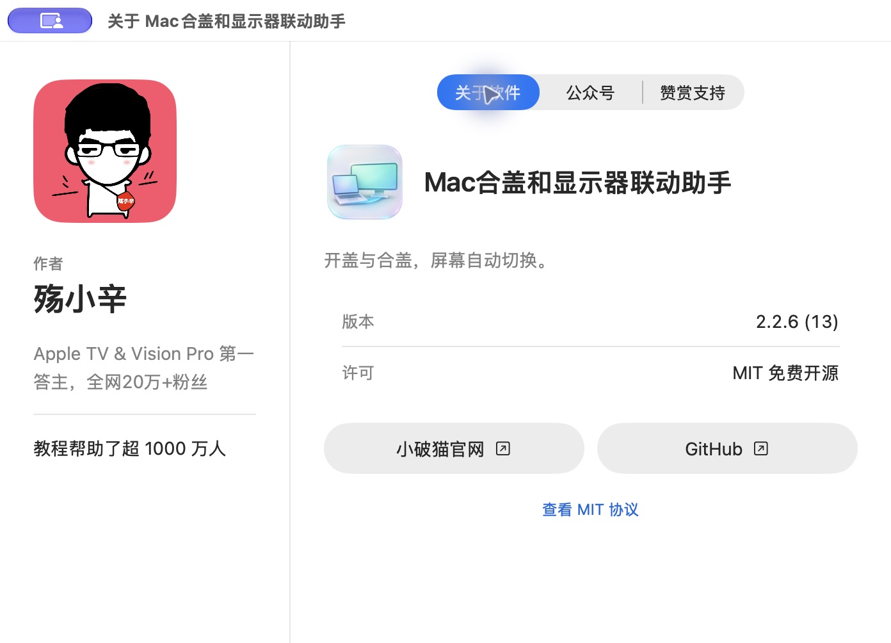

# 安装与使用

## 安装

1. 在 [Releases](https://github.com/xinlaoshi/mac-lid-display-helper/releases) 下载 `MacDisplaySwitch-2.2.7-AppleSilicon.dmg`，或选择 ZIP。
2. 打开 DMG，将“Mac合盖和显示器联动助手.app”拖入 Applications（应用程序）；使用 ZIP 时，解压后将 App 放入“应用程序”。
3. 从“应用程序”打开 App。它显示在顶部菜单栏，不常驻 Dock。
4. 点击菜单栏“开盖 Mac＋显示器”图标，选择“设置…”。

适用 Apple 芯片 Mac，macOS 14+。Intel Mac 不适用。自动开合盖联动面向 MacBook。

## 首次打开的系统提示

v2.2.7-beta.1 安装包内的 App 已使用 Developer ID 签名，通过 Apple 公证并附带票据。系统验证签名时，开发者名称显示为 `jinzhi zhu`；软件作者为殇小辛。

首次打开仍可能出现“从互联网下载，是否打开”的正常确认；确认从本仓库下载后点击“打开”即可，通常无需到“隐私与安全性”手动放行。受管理 Mac 仍可能受组织策略限制。旧测试版的签名状态见对应版本说明。

## 设置显示联动

1. 保持 Mac 上盖打开，接好并开启外接显示器。
2. 进入“设备与输出”，在识别到的设备旁点击“加入联动”。可以设置显示名称与输出偏好。
3. 进入“显示联动”：开盖选择只用 Mac、只用外接屏或同时使用；同时使用可选镜像或扩展，扩展可选择主显示器。
4. 在合盖设置中直接选择要使用的外接屏。
5. 点击“保存”。保存后，下次开合盖按新规则切换；“立即应用”执行已保存且符合当前开合盖状态的规则。
6. 需要随登录运行时，开启“登录后启动”并保存。

## 输出模式

在“设备与输出”中按实际可用模式设置分辨率、刷新率和 HDR。可用组合由 Mac、接口、线材/扩展坞与显示器共同决定。镜像时由 macOS 协调公共模式；独立输出偏好在扩展或单屏时应用。

合盖使用仍需满足 macOS 与硬件的运行条件。电视需开机并选对物理输入源；本工具的“停用”是停止视频输出，不是关闭电视电源。

## 恢复、升级与卸载

显示异常时，先打开 Mac 上盖，再选择菜单栏“恢复所有显示器并暂停”。

升级前保存需要保留的设置，再选择“退出并恢复显示器”，然后用新版替换“应用程序”中的旧 App。升级后请从“应用程序”手动打开新版一次；已有登录启动项会更新为新的 `MacDisplaySwitch` 可执行路径，原有屏幕规则继续保留。当前没有内置自动更新服务。

卸载前关闭“登录后启动”并保存，选择“退出并恢复显示器”，再将 App 移到废纸篓。保留的本地设置与日志位置见[隐私说明](privacy.md)。

## 关于与联系

菜单栏选择“关于…”，或在“使用帮助”中点击“关于…”，采用作者主页布局。左侧介绍作者殇小辛，右侧分为“关于软件”“公众号”“赞赏支持”：可查看版本、MIT协议，访问小破猫官网和GitHub，或打开二维码。点击二维码可放大，按 Esc 或“完成”返回。赞赏完全自愿，不影响功能使用。

